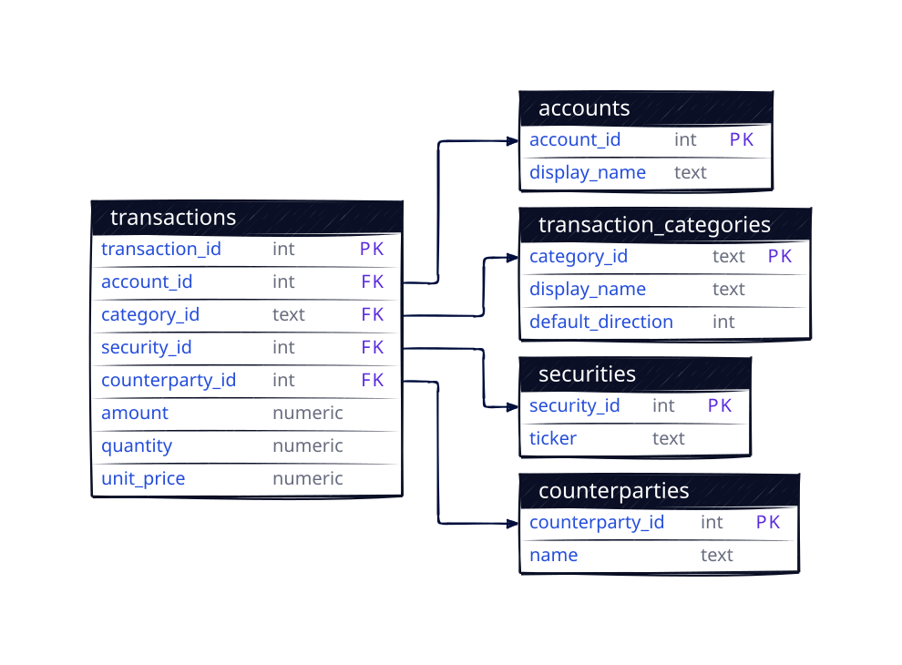

# Doddsville
A personal finance ledger.

## Zig CLI

### Build

```bash
brew install zig          # needs 0.17.x
zig build                 # debug build -> zig-out/bin/dv
zig build -Doptimize=ReleaseSafe   # optimised, still bounds-checked (~3 MB)
zig build test            # unit tests
zig build run -- report summary    # run without installing
```

SQLite (the official amalgamation) is a `build.zig.zon` dependency, downloaded on the
first build and compiled into the binary, so there are no system dependencies. To
upgrade, point `zig fetch` at a newer zip from https://sqlite.org/download.html:

```bash
zig fetch --save=sqlite https://www.sqlite.org/2025/sqlite-amalgamation-3500400.zip
```

Put the binary on your PATH, e.g. `ln -s "$PWD/zig-out/bin/dv" ~/.local/bin/dv`.

### Configuration

Settings live in `~/.config/doddsville/config.zon` (or `$XDG_CONFIG_HOME/doddsville/`).
Without that file `dv` uses `data.db` in the current directory; `--db` always wins.

```zig
.{
    .db = "/Users/me/doddsville/data.db",
    .paperless = .{ .url = "http://nas:8000", .keychain = "doddsville-paperless" },
}
```

The Paperless token is read from that macOS Keychain item:

```bash
security add-generic-password -U -a dv -s doddsville-paperless -w   # prompts for the token
dv config check
```

### Layout

```
build.zig, build.zig.zon
src/
├── main.zig         entry point: argument specs + dispatch (was cli.py)
├── args.zig         small argparse replacement
├── App.zig          per-run context: arena, I/O, config, db, input()
├── Config.zig       config.zon + Keychain token (config.py)
├── sqlite.zig       hand-written SQLite binding (@cImport is gone in 0.17)
├── migrations.zig   PRAGMA user_version migrations (migrations.py)
├── format.zig       money/date parsing + formatting (formatting.py)
├── lookup.zig       account/security resolution (db.py)
├── paperless.zig    paperless-ngx API via std.http.Client (paperless.py)
├── ollama.zig       local Ollama API, the import fallback
├── ui.zig           interactive editors (ui.py, edit parts)
├── pdf/             minimal PDF reader: objects, xref, filters, fonts, text, layout
├── parsers/         deterministic broker parsers (Scalable) + LLM answer validation
└── commands/        account, add, list, edit, report, doc, config, import
```

Intentional differences: `dv list` shows `-` instead of `None` for cash transactions;
`dv --version` reports `doddsville@0.1.0`.

Quantities are stored in millionths of a share (schema v5), so savings-plan fractions
like `0.571234` fit; `dv add buy` accepts them with `.` or `,`. The Python CLI refuses
databases at v5 except for `sensor`, and the TUI refuses them entirely.

### PDF import

```bash
dv import statement.pdf -a "Scalable Broker"   # parse, preview, confirm, insert, upload
dv import statement.pdf --dry-run             # parse and preview only
dv import statement.pdf --no-upload           # skip Paperless
dv import statement.pdf --raw                 # show the extracted text
dv import statement.pdf --parser llm --model llama3.2
```

1. `src/pdf` extracts positioned words (no pdfplumber, no external tools).
2. A deterministic parser claims the document and reads it: Scalable
   Wertpapierabrechnungen (buy/sell) and Kontoauszüge (savings-plan buys, deposits,
   distributions). Parsers refuse documents that fail their own checks: ISIN check
   digits, Kurs × Stück = Kurswert, and statements must reconcile with the opening and
   closing Kontostand.
3. Only if no parser can read the document, `dv` offers to ask a local Ollama model
   (`.ollama = .{ .url = ..., .model = ... }` in `config.zon`, defaults
   `http://localhost:11434` and `mistral`). Its answer is validated like any other input.
4. Securities are matched by ISIN (and can be created from the document), likely
   duplicates of recorded transactions are skipped, and sells beyond the holdings are
   flagged. Everything is previewed and editable before it is written.
5. The PDF is uploaded to Paperless and linked to the new transactions.

Bookings without a matching transaction type (e.g. tax refunds on a Kontoauszug) are
listed but not imported.

---

## Python CLI (legacy, still needed for sensor and the TUI on pre-v5 databases)

## Setup

### 1. Install Dependencies

```bash
pixi install
```

### 2. Install the CLI

This step is required after each `pixi install`:

```bash
pixi run install-cli
```

Or use `pixi run dv` directly (auto-installs the CLI).

### 3. Database Migrations

Database migrations run automatically on every CLI invocation using SQLite's `PRAGMA user_version`. No manual migration step is needed.

## Usage

All commands use `pixi run dv` (or just `dv` if you activate the shell with `pixi shell`).

**Account Management:**

```bash
pixi run dv account add "Broker Name"   # Create account
pixi run dv account list                # List accounts
```

**Record Transactions:**

```bash
# Stock transactions
pixi run dv add buy "Apple" 10 150.00 -a "Broker"
pixi run dv add sell "Apple" 5 160.00 -a "Broker"
pixi run dv add dividend "Apple" 25.00 -a "Broker"

# Cash transactions
pixi run dv add deposit 1000.00 -a "Broker"
pixi run dv add withdrawal 500.00 -a "Broker"
pixi run dv add interest 10.00 -a "Cash"

# Transfer between accounts
pixi run dv add transfer 500.00 --from "Cash" --to "Broker"
```

**Edit Transactions:**

```bash
# Edit an existing transaction (interactive editor)
pixi run dv edit 42
```

**List Transactions:**

```bash
pixi run dv list                    # All transactions
pixi run dv list -a "Broker"        # Filter by account
pixi run dv list -t buy             # Filter by type
```

**Reports:**

```bash
# Summary of all metrics
pixi run dv report summary

# Account balances
pixi run dv report balance

# Cash flow (deposits, withdrawals, dividends, interest)
pixi run dv report cashflow

# Current stock holdings
pixi run dv report holdings

# Investment performance (realized gains/losses)
pixi run dv report performance

# Filter by account or date range
pixi run dv report summary -a "Broker"
pixi run dv report cashflow --from 01.01.2024 --to 31.12.2024
```

## Paperless-ngx Integration

Attach documents to transactions using a paperless-ngx server.

**Setup:**

```bash
# Configure paperless connection
pixi run dv config set paperless_url http://localhost:8000
pixi run dv config set paperless_token your-api-token

# Verify connection
pixi run dv config check
```

**Attach documents to transactions:**

```bash
# Link existing document by paperless ID
pixi run dv add buy "Apple" 10 150.00 -a "Broker" --doc 123

# Upload new document (auto-uploads to paperless)
pixi run dv add buy "Apple" 10 150.00 -a "Broker" --doc ./receipt.pdf

# Multiple documents
pixi run dv add deposit 1000.00 -a "Broker" --doc 123 ./statement.pdf
```

**Add documents to existing transactions:**

```bash
# Link by paperless document ID
pixi run dv doc add 42 123

# Upload and link a file
pixi run dv doc add 42 ./receipt.pdf

# Multiple documents at once
pixi run dv doc add 42 123 456 ./statement.pdf
```

**Edit document metadata:**

```bash
# Edit metadata of a Paperless document (title, correspondent, type, etc.)
pixi run dv doc edit 123
```

If the document is linked to transactions in dv but the `dv_transaction_id` custom field is missing (e.g. due to a previous error), `doc edit` will automatically set it.

Documents are shown as clickable URLs in `dv list` output.

**Transaction ID custom field:**

When documents are linked to transactions (via `dv add --doc`, `dv doc add`, or `dv import`), a `dv_transaction_id` custom field is automatically set on the Paperless document containing the linked transaction ID(s) as a comma-separated string (e.g. `"1,2,3"`). This allows navigating from Paperless back to the corresponding `dv` transactions. The custom field is created automatically on first use. If multiple transactions reference the same document, the IDs are merged.

### Index Parsing

Parse all indices provided in `init.sql` and add their companies to the `company` table:

```bash
pixi run python index.py
```

### Running Tests

```bash
pixi run pytest test_cli.py -v
```

## Project Structure

```
doddsville/
├── cli.py              # Entry point: argparse setup + dispatch
├── config.py           # Config directory/file management
├── db.py               # DB helpers (get_or_prompt_account/company, holdings)
├── formatting.py       # ANSI codes, currency formatting, validators
├── migrations.py       # Schema migrations via PRAGMA user_version
├── paperless.py        # Paperless-ngx API + document helpers
├── ui.py               # Interactive transaction and document editors
├── commands/           # Command handler modules
│   ├── account_cmd.py  #   account add/list
│   ├── add_cmd.py      #   add buy/sell/dividend/interest/deposit/withdrawal/transfer
│   ├── config_cmd.py   #   config show/set/check
│   ├── doc_cmd.py      #   doc add/edit
│   ├── edit_cmd.py     #   edit transaction
│   ├── list_cmd.py     #   list transactions
│   └── report_cmd.py   #   report summary/balance/cashflow/holdings/performance
├── schema.sql          # Full schema for fresh/test databases
└── test_cli.py         # Test suite
```

## Database Schema



The schema contains the following tables:

- **account** - Financial accounts (brokers, cash accounts)
- **company** - Stock/security information (ISIN, name)
- **transaction** - All transaction records with types: buy, sell, dividend, interest, deposit, withdrawal, transfer
- **transaction_document** - Links transactions to paperless-ngx documents
- **index** - Stock market indices
- **raw_html** - Cached HTML data for scraping

## Tools

- [Pixi](https://pixi.sh) - Package and environment management
- [SQLite CLI](https://sqlite.org/cli.html) - Database interaction
- [D2](https://d2lang.com/) - Diagram language for the schema visualization
- [Ollama](https://ollama.com/) - Optional local LLM, the last resort for PDF import
